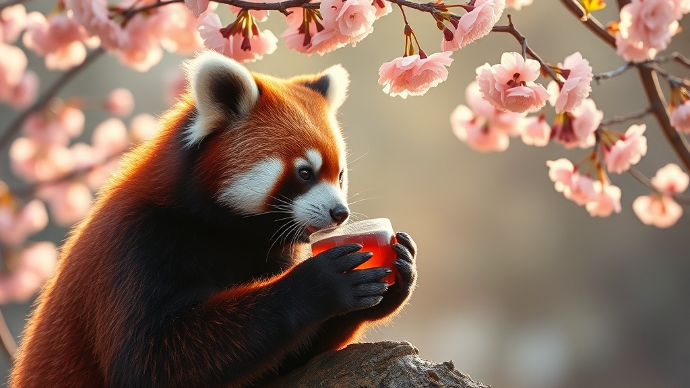

# Pollinations Poster Studio

[](https://pollinations.ai/?ref=badge)

An agent skill that turns a short brief into a finished poster image plus a ready-to-post caption, using Pollinations image models.

## Use

1. Copy `SKILL.md` into your agent's skills folder.
2. Set your Pollinations key: `export POLLINATIONS_API_KEY=...`
3. Ask your agent for a poster, or run the helper directly:

```bash
python3 scripts/make_poster.py "a red panda drinking tea under cherry blossoms, soft morning light" poster.png
```

The helper saves the generated image to the path you give. Generation uses your own Pollinations balance.

## Example


